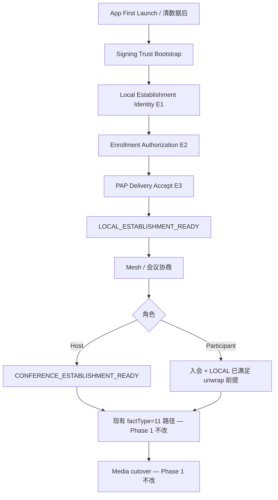

# ESTABLISHMENT-ENROLLMENT-PRODUCTIZATION-001

**Status:** APPROVED — Phase 1 **Recovery path implemented**; **主入组 UX SUPERSEDED** by GKE（见 `GKE-CODE-REUSE-ASSESSMENT.md`）  
**Decision:** B-first 仅适用于 **Operator Recovery**；量产主路径 = **Group-Key Establishment（GKE）**  
**Owner:** Product architecture  
**Date:** 2026-11-05  

---

## 0. 文档地位

本文档描述 **PAP signed delivery 的 App 内 Recovery 路径**（已实现：Coordinator + Base64 粘贴）。  

**主产品目标（2026-11-05 确认）：** 新装设备 **仅** 通过现有设置（含 sharedSecret）+ 开服务，**自动**建立 Establishment binding（**GKE**）—— **不以** 本文 UX 为主路径。

| 文档 | 关系 |
|------|------|
| **`GKE-CODE-REUSE-ASSESSMENT.md`** | **主路径** 代码评估与 Phase 0 Spike |
| 本文 | **Recovery / 运维**；已实现代码 **保留**，**冻结** 主 UX 迭代 |

**Phase 1 授权范围（冻结）：**

- 只实现 **Enrollment 工作流 + Readiness Gate + 用户可见状态**。
- **不修改**：factType=11 协议与实现、Mesh 协商、AQC、672ea22 / SOURCE coalescer、`REGRESSION-SOURCE-ORIGIN-RETRY-001` 修复线。

---

## 1. 问题陈述

当前生产路径：

```text
Signing Trust     → LabDeploymentTrustBootstrap（App 启动自动）→ CREATION / MEMBERSHIP 可签
Establishment Trust → 运维 EP + PAP + androidTest（App 外）→ media-key 包装 /  unwrap 可工作
```

**清数据 / 新装** 只恢复第一层；第二层缺失时，主机侧典型表现为 `UNKNOWN_ESTABLISHMENT_MODULE`、`SKIPPED_LOOKUP`，与会者 supplement 无法物化。**这不是**「再写一套启动灌 `.bin`」，而是缺少 **面向新设备的授权入网产品流程**。

场测对照（证据见 `field-logs/aqc-voice-20261105-160149/`，分析见 `field-logs/trust-bootstrap-aqc-20261104-161154/FIELD_SUMMARY.txt`）：

- 保留历史 EP provision 文件 → 媒体可通。
- `pm clear` 且仅 Signing bootstrap → 媒体断。

---

## 2. 产品目标

> 新手机安装 App，完成 **必要的一次性授权** 后，能发现已有会议、加入会议并 **正常双向语音**。  
> 不需要 ADB、不需要工程师跑脚本、不需要 **每加一台机就给全 fleet 重灌密钥**。

**不是**「App 启动时自动生成一把密钥」——那是 **E1 身份生成**；产品是 **Enrollment（身份 + 授权 + 验证 + 持久化 + Readiness）**。

---

## 3. 两层 Trust（职责不可合并）

| 层 | 职责 | 现有组件 | Phase 1 |
|----|------|----------|---------|
| **Signing Trust** | 验证并签署 CREATION、成员事实等 | `LabDeploymentTrustBootstrap`、`accepted-local-trust-state.bin` | 保持；先于 Establishment 执行 |
| **Establishment Trust** | 本机 Keystore 身份 + **经授权的** peer RSA 公钥 binding；支撑 media-key 包装/unwrap | `AndroidKeystoreLocalEstablishmentIdentityStore`、`EstablishmentProfileRevisionDeliveryAcceptor`、`accepted-local-establishment-trust-state.bin`、`Profile01ProfileBackedRecipientEstablishmentKeyLookup` | **产品化 Enrollment** |

**必须区分的错误直觉：**

- HELLO 发现设备 ≠ 已授权 Establishment。
- 成员列表可见 ≠ 可获得 media-key。
- Keystore 已创建 ≠ 其他设备已信任该身份。
- `accepted-local-establishment-trust-state.bin` **存在** ≠ Readiness（须验证链路与 possession）。

---

## 4. 四个设计边界（立项冻结）

### 4.1 两种 READY（禁止混用）

| 名称 | 含义 | 典型检查 |
|------|------|----------|
| **`LOCAL_ESTABLISHMENT_READY`** | 本机 Establishment **身份 + 授权链 + 持久化** 有效 | `Profile01VerifiedLocalEstablishmentIdentity.resolve` → `Verified`；store 与 Keystore 一致；taskProfileRevision 单调 |
| **`CONFERENCE_ESTABLISHMENT_READY`** | **当前会议** roster 上，本机角色所需的 **peer binding** 均可 lookup | Host：`Profile01RecipientEstablishmentKeyLookup.activeEstablishmentKey(peer)` → `Found` 对 **当前 snapshot 中需发包/收包的 peer 集合**；Participant：至少 `LOCAL` + 能 unwrap 来自 Host 的 package（binding 含 Host + 必要 peer 策略见 §8.3） |

全局 UI「设备已就绪」应对齐 **`LOCAL_ESTABLISHMENT_READY`**。  
建会 / 发 invite / Host 侧 media-key 义务应对齐 **`CONFERENCE_ESTABLISHMENT_READY`**（可按 session 计算）。

### 4.2 Enrollment 必须幂等

- App 重启、重复提交 **同一** signed delivery、网络中断恢复：**不得**重复生成 Keystore 身份或破坏已有效 trust state。
- 依赖现有语义：`LocalEstablishmentKeystoreProvisionResult.AlreadyProvisioned`、`EstablishmentProfileRevisionDeliveryAcceptResult.Accepted(idempotent=true)`、acceptor 的 revision 冲突规则。
- Coordinator 须持久化 **enrollment 阶段状态**（见 §6），避免 UI 重复触发并行 accept。

### 4.3 失败不能伪装成 READY

以下 **单独** 均 **不是** READY 证据：

- 文件存在但未 reload / 未 verify。
- Keystore `Created` 但 profile binding 缺失或 SPKI 不匹配。
- PAP HTTP/Intent 返回成功但未经过 `EstablishmentProfileRevisionDeliveryAcceptor` 完整链路。
- Host 仅本地 supplement material 就绪（`HOST_LOCAL_SUPPLEMENT READY`）但 peer lookup 失败。

READY 必须执行 **§7 E1–E4** 对应验证并通过。

### 4.4 故障隔离（与 SOURCE regression 独立）

| 跟踪项 | 根因层 | 本文档关系 |
|--------|--------|------------|
| **`REGRESSION-SOURCE-ORIGIN-RETRY-001`** | 672ea22 / SOURCE origin·coalescer·binding 时序（material 已就绪仍 `NO_BUILT_SOURCE` 等） | **独立保留**；Establishment 缺失 **不能** 作为关闭该 RCA 的理由；基线 bisect 仍须单独裁决 |
| **Establishment 缺失** | 清数据 / 新装无授权 trust → `UNKNOWN_ESTABLISHMENT_MODULE` | **本文 Phase 1 解决** |

同表象 `NO_MEMBER_BINDING` 可能来自不同层；日志须带 **Readiness / Enrollment 阶段** 与 **Origin 阶段** 分列诊断。

---

## 5. 目标架构（端到端）



Phase 2 在 **D** 插入 `EnrollmentAuthorityPort`（二维码 / 管理员设备 / 离线 LAN）。  
Phase 3 在 store **`atomicReplace`** 后接 **C**：增量 binding → Supplement Obligation 唤醒（**不**在 Phase 1 订阅）。

---

## 6. Enrollment 状态机（Coordinator）

### 6.1 状态一览

| 状态 | 用户可见（建议） | 说明 |
|------|------------------|------|
| `SIGNING_PENDING` | 正在初始化签名信任… | 等待 `LabDeploymentTrustBootstrap` 完成或已 `AlreadyReady` |
| `SIGNING_FAILED` | 无法初始化签名信任 | 阻断；见 `DEPLOYMENT_TRUST bootstrap FAIL` |
| `LOCAL_IDENTITY_PENDING` | 正在创建设备身份… | E1：Keystore provision |
| `LOCAL_IDENTITY_FAILED` | 设备身份创建失败 | 不可重试或需用户操作（Keystore 损坏） |
| `AWAITING_ENROLLMENT` | 等待授权入网 | 无有效 establishment profile；引导授权入口 |
| `ENROLLMENT_SUBMITTED` | 正在验证授权… | 已收到 signed delivery，accept 进行中 |
| `LOCAL_ESTABLISHMENT_READY` | 设备已就绪 | E1–E4 通过 |
| `ENROLLMENT_REJECTED` | 授权被拒绝 | 可展示原因码；允许 **换一份** 合法材料重试 |
| `ENROLLMENT_STALE` | 需要重新授权 | 例如 domain/revision 与本地 module 不匹配；不清 Keystore 除非策略要求 |

**`CONFERENCE_ESTABLISHMENT_READY`** 不是 Coordinator 持久状态；由 **`EstablishmentReadinessGate`** 按 **conferenceId / sessionId** 瞬时评估（见 §8）。

### 6.2 转换条件

```text
[*] → SIGNING_PENDING
  on start(): ensureIfNeeded Signing
  Signing Failed → SIGNING_FAILED (terminal until retry)
  Signing OK → LOCAL_IDENTITY_PENDING

LOCAL_IDENTITY_PENDING
  provisionFirstIdentity → Created | AlreadyProvisioned → evaluateLocalProfile()
  evaluateLocalProfile: Verified → LOCAL_ESTABLISHMENT_READY
  evaluateLocalProfile: missing profile → AWAITING_ENROLLMENT
  provision Failed → LOCAL_IDENTITY_FAILED

AWAITING_ENROLLMENT
  user submits signedDelivery → ENROLLMENT_SUBMITTED
  (optional) reloadFromPersistence + evaluate → LOCAL_ESTABLISHMENT_READY if already enrolled

ENROLLMENT_SUBMITTED
  acceptSignedDelivery → Accepted → evaluateLocalProfile → LOCAL_ESTABLISHMENT_READY
  AuthenticationRejected | SemanticRejected | RollbackRejected → ENROLLMENT_REJECTED
  RevisionConflictRejected → if idempotent replay → LOCAL_ESTABLISHMENT_READY else ENROLLMENT_REJECTED
  PersistenceFailed → ENROLLMENT_REJECTED (retain previous snapshot)

LOCAL_ESTABLISHMENT_READY
  on clearData / trustDir wiped → AWAITING_ENROLLMENT or LOCAL_IDENTITY_PENDING
  on superseding revision (Phase 3 policy) → ENROLLMENT_SUBMITTED or AWAITING_ENROLLMENT
```

**幂等规则：**

- 处于 `LOCAL_ESTABLISHMENT_READY` 时重复提交 **相同 revisionIdentity** 的 delivery → 保持 READY，记录 `ENROLL_IDEMPOTENT_IGNORED`。
- 处于 `ENROLLMENT_SUBMITTED` 时禁止并发第二次 accept（队列或单飞锁）。

### 6.3 持久化

Coordinator 在 `filesDir/gbc-trust/` 维护 **非信任** 元数据（例如 `enrollment-coordinator-state.json`）：

- 最后成功 `taskProfileRevision` / `revisionIdentity` 摘要（用于幂等与 UI）。
- 最后失败码与时间（用于支持）。

**不得** 在该文件中存放私钥或替代 `accepted-local-establishment-trust-state.bin`。

---

## 7. 验收关口 E1–E6 与 Phase 1 签收边界

### 7.1 Phase 1 实现验收（必须通过）

**Enrollment 代码交付以 E4 为界。** 下列关口是 Phase 1 PR 合并与阶段签收的 **必要条件**；须用 log / 探针 / 单元或仪器化测试证明，**不能**仅用 UI 文案代替。

| 关口 | 名称 | 通过条件（可观测） |
|------|------|-------------------|
| **E1** | Local Identity | Keystore provision/load 成功；`EstablishmentEnrollmentEvidenceProducer` 等价证据可生成（Phase 1 可仅内部 log） |
| **E2** | Enrollment | signed delivery 经 `EstablishmentProfileOperationalAuthenticator`；fleet / `deploymentTrustDomainId` / moduleId 与配置一致 |
| **E3** | Peer Binding | accept 后 snapshot 含 **本机 ACTIVE binding** 及 **策略要求的 peer bindings**（lab 五机：M01 store 含 M02–M05 等，与 2026-10-27 已验证 revision 一致） |
| **E4** | Persistence | 杀进程重启后 `reloadFromPersistence` + `Profile01VerifiedLocalEstablishmentIdentity.resolve` 仍为 Verified；**不**重复 provision |

**Phase 1 真正交付物：** 新装 / 清数据设备可在 **App 内** 完成授权、写入 `accepted-local-establishment-trust-state.bin`、重启后 **仍 Verified**——而非仅显示 READY。

### 7.2 下游集成场测（须记录，非 Phase 1 代码验收条件）

E5–E6 在 Phase 1 末期 **建议** 做五机场测并 **完整落盘**（`field-logs/`），但：

- **不作为** Enrollment 实现 PR 的合并阻塞条件；
- **若失败**，单独归入 **媒体链路 / factType=11 / Mesh / SOURCE / AQC / 672ea22** 等既有跟踪项，**不得**借此扩大 Phase 1 范围或修改 factType=11、Mesh、AQC、672ea22。

| 关口 | 名称 | 通过条件（可观测） |
|------|------|-------------------|
| **E5** | Media Key | factType=11 EMITTED / 对端 ingest / ACK（**现有路径**；Phase 1 不改协议） |
| **E6** | Meeting | 双向语音正常（场测；非「UI Connected」） |

**安全场景（Phase 1 设计须覆盖，实现可测例驱动）：**

- 未授权 delivery → `ENROLLMENT_REJECTED`，不得 READY。
- 错误 fleet / 错误 module / 重放旧 revision（rollback 规则）→ reject。
- 重启不重复申请、不破坏已有 identity（E4）。

---

## 8. 组件职责与挂载点

### 8.1 `EstablishmentEnrollmentCoordinator`

**包建议：** `com.talkback.appprod.enrollment`（或 `core.session.gbc.enrollment` 若需 board 共享）

**职责：**

1. 编排 §6 状态机；暴露 `EnrollmentUiState` 与 `EnrollmentFailureCode`。
2. 调用 **现有** 生产组件（不复制 PAP 密码学）：
   - `AndroidKeystoreLocalEstablishmentIdentityStore`
   - `EstablishmentProductionComposition` / `EstablishmentProfileRevisionDeliveryAcceptor`
   - `Profile01VerifiedLocalEstablishmentIdentity`
3. 向 `EnrollmentAuthorityPort` 获取 **待接受的 signed delivery**（Phase 1：运维 OOB 生成 + App 内文件或 Base64 粘贴；Phase 2：管理员 UX、QR、LAN 交付）。
4. 在成功 accept 后触发 **`EstablishmentReadinessGate.invalidateLocal()`**。
5. 结构化日志前缀建议：`ENROLLMENT_COORDINATOR`（与 `DEPLOYMENT_TRUST` 并列）。

**非职责：** 发送 factType=11、修改 Mesh、解析 HELLO 为 trust、写入 signing store。

### 8.2 `EstablishmentReadinessGate`

**职责：**

```kotlin
// 设计接口（Phase 1 实现；Kotlin 仅为文档）
interface EstablishmentReadinessGate {
    fun localReadiness(): LocalEstablishmentReadiness
    fun conferenceReadiness(sessionId: String, snapshot: ConferenceTopologySnapshot): ConferenceEstablishmentReadiness
    fun invalidateLocal()
    fun invalidateConference(sessionId: String)
}
```

**`LocalEstablishmentReadiness`：** 映射 `Profile01LocalEstablishmentIdentityAvailability` + store 非空 + revision 单调。

**`ConferenceEstablishmentReadiness`：**  
- **Host（membership authority）：** 对 `eligiblePeerModuleIds`（现有 fanout 同源集合）逐个 `activeEstablishmentKey`；任一非 `Found` → `NOT_READY`，明细 `missingPeers`。  
- **Participant：** `LOCAL_ESTABLISHMENT_READY` 且 Host binding 可用（lookup Host moduleId）。

**挂载点（Phase 1 须实现）：**

| 位置 | 行为 |
|------|------|
| `TalkbackRuntimeManager.start()` | Signing bootstrap 完成后 **`coordinator.resumeOrStart()`**；runtime 创建 **前或后** 均可，但 **建会前** 须可读 readiness |
| `TalkbackRuntimeManager.initiateChannelMeshCall` / conference create | 已有 `isProfile01CreationSignerReady` **之后** 增加：`localReadiness().ready`；Host 路径在 `submitMeetingStartIntent` **之前** 可先做 **局部** conference check（仅已知 invite 目标） |
| `TalkbackCoordinator` Host membership wire fanout 前 | 若已有 seam，调用 `conferenceReadiness`；**Phase 1 可选 log-only**，Phase 1.1 可 hard block 避免 `UNKNOWN_ESTABLISHMENT_MODULE` 风暴 |
| `TalkViewModel` / `TalkFragment` | 展示「等待授权 / 设备已就绪 / 会议加密未就绪」；**不**用 `ChannelReadiness.DIRECTORY_SYNC` 代替 Establishment |
| `acceptPendingConferenceInvite` | 要求 `LOCAL_ESTABLISHMENT_READY`；否则 reject + 用户提示 |

### 8.3 `TalkbackRuntimeManager.start()` 集成顺序（冻结）

```text
1. stop()  prior runtime
2. LabDeploymentTrustBootstrap.ensureIfNeeded()     // Signing — 已有
3. EstablishmentEnrollmentCoordinator.onRuntimeStarting(context, moduleId)
      → 可能长时间 AWAITING_ENROLLMENT（不阻塞步骤 4 与否：见决策）
4. TalkbackRuntimeFactory.create(...)                  // 已有
5. runtime.start()
6. coordinator.onRuntimeStarted(runtime)               // 注册 gate 所需 authoritySurface 引用
```

**推荐决策（Phase 1）：**

- **允许** 在 `AWAITING_ENROLLMENT` 时启动 runtime（便于发现会议、展示授权 UI），但 **禁止** 发起 Host create / 接受需 media 的 invite（hard gate）。
- **禁止** 在 `SIGNING_FAILED` 时启动 runtime（与现有 CREATE gate 一致）。

### 8.4 建会 / 入会阻断策略

| 动作 | Signing gate | Local Establishment | Conference Establishment |
|------|--------------|---------------------|---------------------------|
| Host 创建会议 | 已有 | **必须 READY** | invite 列表非空时 **必须** 对 invitees lookup 全 Found |
| Participant 接受 invite | 已有 | **必须 READY** | N/A（unwrap 依赖 Host package） |
| 仅浏览 UI / 非会议 mesh | — | 可 AWAITING（产品定） | — |

阻断时 **必须** 返回明确原因码（§9），禁止 silent `return null` 无日志（改进现有 `Blocked conference create: DEPLOYMENT_TRUST` 模式）。

---

## 9. 失败码与恢复策略

### 9.1 Enrollment 层（Coordinator）

| 码 | 含义 | 用户动作 | 系统动作 |
|----|------|----------|----------|
| `E_SIGNING_BOOTSTRAP_FAILED` | Signing bootstrap 失败 | 重启 App；检查存储 | 不启动 runtime |
| `E_KEYSTORE_PROVISION_FAILED` | E1 失败 | 重启；系统 Keystore 异常则换机 | 状态 → `LOCAL_IDENTITY_FAILED` |
| `E_AWAITING_ENROLLMENT` | 无 profile | 完成授权流程 | 展示授权入口 |
| `E_ENROLL_AUTH_REJECTED` | PAP 验签失败 | 重新获取授权 | 保留 Keystore |
| `E_ENROLL_SEMANTIC_REJECTED` | fleet/module 不匹配 | 联系管理员 | 保留 Keystore |
| `E_ENROLL_REVISION_CONFLICT` | 非幂等冲突 | 获取最新 revision | 不清 store 除非运维策略 |
| `E_ENROLL_PERSIST_FAILED` | 磁盘失败 | 释放空间后重试 | 旧 snapshot 仍有效 |
| `E_LOCAL_VERIFY_FAILED` | SPKI/版本与 Keystore 不一致 | **重新授权**（可能需运维撤销旧 binding） | 禁止 READY |
| `E_ENROLL_IDEMPOTENT_OK` | 重复提交已接受 revision | 无 | 保持 READY |

### 9.2 Readiness / 会议层（Gate）

| 码 | 含义 | 恢复 |
|----|------|------|
| `R_LOCAL_NOT_READY` | 未完成 Enrollment | 完成 §6 |
| `R_CONFERENCE_PEER_MISSING` | Host 缺 peer binding | Phase 1：重新发放含该 peer 的 revision；Phase 3：增量授权 |
| `R_CONFERENCE_HOST_UNKNOWN` | Participant 缺 Host binding | 同 enrollment 更新 |
| `R_LOOKUP_KEY_NOT_USABLE` | binding 存在但非 ACTIVE | 等待新 revision 或 Phase 3 轮换 |

### 9.3 与现有 Profile01 日志对齐

实现时应映射而非替换：`UNKNOWN_ESTABLISHMENT_MODULE`、`MISSING_ESTABLISHMENT_PROFILE`、`SKIPPED_LOOKUP` 等仍可在 coordinator 打 **因果前缀** `enrollmentPhase=... readiness=...`。

---

## 10. `EnrollmentAuthorityPort`（Phase 1 Lab / Phase 2 产品）

**目的：** 在 **无 adb instrument** 的前提下，让 App 获得 **signed establishment profile delivery** 并交给现有 acceptor。

```kotlin
interface EnrollmentAuthorityPort {
    /** 本机 E1 完成后，向 Authority 注册 enrollment 请求（含 public evidence）。 */
    suspend fun submitEnrollmentRequest(evidence: EnrollmentPublicEvidence): EnrollmentRequestHandle

    /** 阻塞或回调：返回经 PAP 签名的 delivery bytes。 */
    suspend fun awaitSignedDelivery(handle: EnrollmentRequestHandle): SignedDeliveryResult

    sealed class SignedDeliveryResult {
        data class Delivered(val signedDeliveryBytes: ByteArray) : SignedDeliveryResult()
        data class Rejected(val reason: String) : SignedDeliveryResult()
        data object Cancelled : SignedDeliveryResult()
    }
}
```

**Phase 1 实现（`LabEnrollmentAuthorityPort`）：**

- **运维工作站**（非 App、非 adb instrument 主路径）按现有 EP 工具链生成 signed delivery。
- 用户将 delivery 送入 App：**本地文件导入** 或 **Base64 粘贴**（调试/实验室菜单即可；**不含** QR 扫描、不含 LAN 自动发现交付）。
- 行为等价于今日 `EpEstablishmentOperatorProvisionSupport.writeSignedEstablishmentDeliveryFromBase64` + accept；**Authority 私钥与 fleet 策略 secret 不进 APK**。

**Phase 2 实现：** 管理员授权 UX、**QR**、**LAN** 交付 signed delivery；仍走 **同一** `acceptSignedDelivery`。**第一个 PR 不得提前实现 Phase 2 UI。**

---

## 11. Phase 3 — Store 变更通知（C 兼容，Phase 1 仅接线预留）

核心类型 **已存在于** `AcceptedLocalEstablishmentTrustStateStore`：

- `AcceptedEstablishmentTrustStateListener.onSnapshotReplaced(previous, next, newlyMaterializedPeerModuleIds)`
- `AcceptedEstablishmentTrustStateDiff.newlyMaterializedPeerModuleIds`

**Phase 1：** Coordinator / Gate **注册 listener 为空操作或仅 log**（可选）。  
**Phase 3：** `MeetingProfile01MediaKeyPackageOriginBridge` / Supplement Delivery Coordinator 订阅 `newlyMaterializedPeerModuleIds` → 唤醒 obligation → 现有 factType=11（**不**合并状态机）。

**禁止：** listener 内直接发送 factType=11；须走现有 Host fanout / obligation 入口。

---

## 12. 安全边界与禁止事项

| 允许 | 禁止 |
|------|------|
| App 内 Keystore 生成本机 RSA 身份 | 本机私钥离设备 |
| 经 PAP/Operational Anchor 验签的 delivery 写入 store | HELLO / mesh gossip **直接**写 establishment store |
| 授权后 peer binding | 把 HELLO 公钥当可信 establishment |
| 复制 **授权 delivery**（signed bytes）到新机 accept | 复制 **`accepted-local-establishment-trust-state.bin`** 当通用模板（清数据后应 **重新 accept**） |
| Lab 固定 fleet **策略** | Lab **私钥 / 共享 secret** 硬编码进 release APK |
| Phase 1 使用 OOB 签发材料 | 新建第二套 EP 密码体系或平行 bootstrap 对象 |

C 的正确链（Phase 3，设计冻结）：

```text
发现新设备 → 取得授权材料 → 验证 Authority → 确认 fleet/policy
→ 建立 peer binding → atomicReplace store → 唤醒 Supplement Obligation → factType=11 → ACK
```

---

## 13. 无 ADB 五机实验室验收方案

**前提：** 五台全新安装或 `pm clear` 后 **无** `accepted-local-establishment-trust-state.bin`；Signing bootstrap 自动 OK。

**授权材料（Phase 1，与 §10 一致）：** 由 **运维工作站** 生成 signed delivery（与 2026-10-27 fleet 策略一致）；每台 App 通过 **文件导入或 Base64 粘贴** 完成 accept。**不使用 QR、不使用 LAN 自动交付**（属 Phase 2）。

### 13.1 Phase 1 签收步骤（E1–E4，必须通过）

1. 五机安装同一 Phase 1 APK；冷启动；确认 `DEPLOYMENT_TRUST bootstrap OK`。
2. 每台 App 内导入/粘贴 delivery 并完成 accept；须同时满足：
   - UI / 状态机：`LOCAL_ESTABLISHMENT_READY`；
   - log：`ENROLLMENT_COORDINATOR state=LOCAL_ESTABLISHMENT_READY`；
   - 探针：`Profile01VerifiedLocalEstablishmentIdentity` → Verified；
   - 文件：`accepted-local-establishment-trust-state.bin` 存在且 reload 有效。
3. 杀进程重启五机 → **E4**：仍 Verified，无重复 Keystore provision log。
4. （建议）M01 Host 建会前：`EstablishmentReadinessGate.conferenceReadiness` → **`CONFERENCE_ESTABLISHMENT_READY`**；M01 无 `UNKNOWN_ESTABLISHMENT_MODULE` 风暴。  
   此步验证 **Enrollment 导致的 Host lookup**，仍属 E1–E4 链上的 Readiness，**不**要求 E6 语音成功。

**Phase 1 阶段签收：** 完成 §13.1 即视为 Enrollment 产品化 Phase 1 闭合。

### 13.2 建议场测（E5–E6，记录但不阻塞 Phase 1）

5. 全场 accept 会议；观察 factType=11、双向语音（**E5–E6**）。
6. 结果写入 `field-logs/<run-id>/`（含 `ENROLLMENT_SUMMARY.txt` 与 media 摘要）。
7. **E5/E6 失败不否决 Phase 1**；RCA 指向媒体/SOURCE/672ea22 等独立项，不得倒逼修改 Enrollment Phase 1 范围。

**扩展场景（Phase 2+ 签收，Phase 1 仅文档预留）：**

- M03 单独清数据 → 仅 M03 重新授权，不重 provision M01/M02/M04/M05。
- M06 新增 → 增量 revision（Phase 3）。
- 未授权机尝试入会 → 阻断。

**证据落盘：** `field-logs/<run-id>/`（logcat + `ENROLLMENT_*` 摘要）；**设计决策以本文为准**。

---

## 14. 实施分期路线图

| 阶段 | 内容 | 退出标准 |
|------|------|----------|
| **Phase 1**（当前立项） | Coordinator + Gate + UI 状态 + Lab `EnrollmentAuthorityPort`（文件/Base64） | §13.1 五机无 adb **E1–E4** 通过 |
| **Phase 2** | 管理员授权 UX、**QR**、**LAN** 交付；减少 OOB 文件依赖 | 新装单台 ≤ 一次用户操作入网 |
| **Phase 3** | 增量成员、store listener → obligation、撤销/轮换 | §12 C 链 + 672ea22 无关的增量场测 |

**明确不做（Phase 1）：** factType=11、Mesh、AQC、672ea22 修改、`REGRESSION-SOURCE-ORIGIN-RETRY-001` 关闭。

---

## 15. Phase 1 PR 拆分顺序（实施裁决）

每个 PR **仅**改 Enrollment 相关代码；**不碰** factType=11、Mesh、AQC、672ea22。

| 顺序 | PR 范围 | 对应关口 |
|------|---------|----------|
| **PR-1** | E1：封装 Keystore 身份创建与复用（`AlreadyProvisioned` 路径） | E1 |
| **PR-2** | E2/E3：接入现有 PAP `DeliveryAcceptor`；授权材料 accept + peer binding 验证 | E2, E3 |
| **PR-3** | E4：reload、verify、幂等恢复；Coordinator 持久化元数据 | E4 |
| **PR-4** | Coordinator + `EstablishmentReadinessGate`；挂接 `TalkbackRuntimeManager.start()`；两种 READY | E1–E4 + Gate |
| **PR-5** | UI + 建会/入会阻断；`LabEnrollmentAuthorityPort`（**文件 / Base64 仅**） | E1–E4 可演示 |

合并门槛：PR-5 合并前至少一台设备跑通 **§13.1**；PR-1–PR-4 可用单元/仪器化探针替代全场测。

---

## 16. 参考代码索引（实现时使用）

| 能力 | 类型 / 路径 |
|------|-------------|
| Signing bootstrap | `LabDeploymentTrustBootstrap`, `TalkbackRuntimeManager.start()` |
| Keystore E1 | `AndroidKeystoreLocalEstablishmentIdentityStore` |
| PAP accept E2–E3 | `EstablishmentProfileRevisionDeliveryAcceptor` |
| Local verify | `Profile01VerifiedLocalEstablishmentIdentity` |
| Host lookup | `Profile01ProfileBackedRecipientEstablishmentKeyLookup` |
| Store + listener | `AcceptedLocalEstablishmentTrustStateStore` |
| androidTest 参考 | `EpEstablishmentOperatorProvisionSupport` |
| 编排参考 | `EstablishmentEnrollmentWorkflow.publishAcceptAndVerify`（单元已证；App 侧 split delivery 步骤） |
| CREATE gate 先例 | `TalkbackRuntimeManager.isProfile01CreationSignerReady` |

---

## 17. 变更记录

| 日期 | 变更 |
|------|------|
| 2026-11-05 | 立项批准；B-first C-compatible；Phase 1 设计基线落盘 |
| 2026-11-05 | 澄清 Phase 1 授权入口（文件/Base64 vs Phase 2 QR/LAN）；E1–E4 与 E5–E6 签收边界；§15 PR 拆分顺序 |
| 2026-11-05 | 主 UX 让位 GKE；本文降为 Recovery；见 `GKE-CODE-REUSE-ASSESSMENT.md` |
